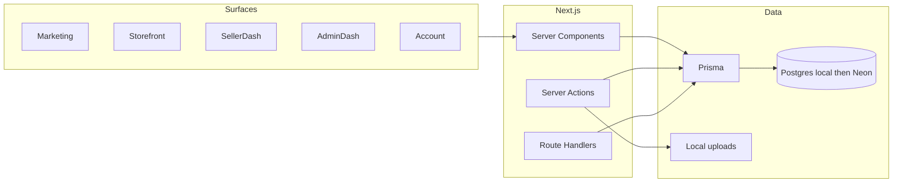
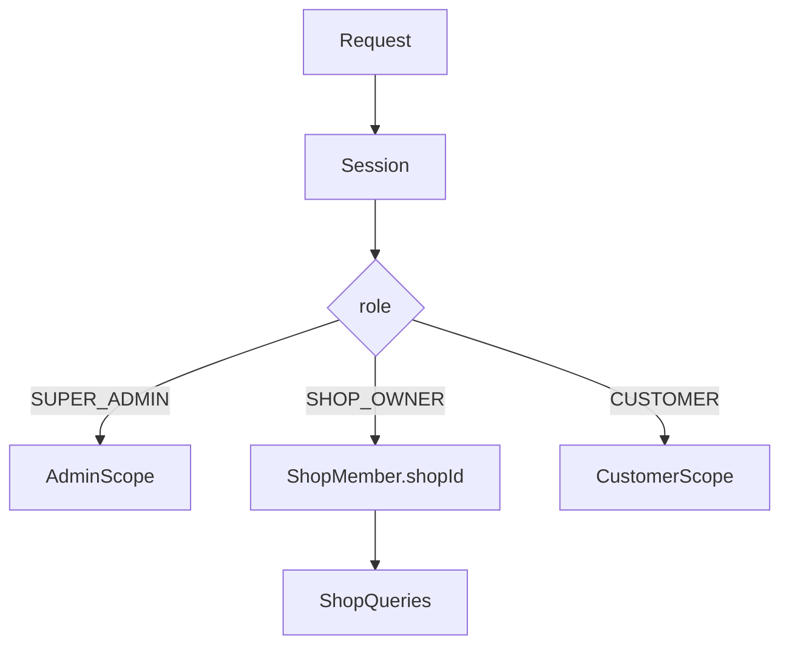

# NexDrop local commerce SaaS

Empty workspace at `C:\Users\Acer\coding\clients\shopee`. New Next.js app in that folder. Product name **NexDrop**. Tagline: **Local commerce, simplified.** No Shopee branding.

Local-first: Docker Postgres + Prisma. Schema stays Neon-compatible (`Decimal`, FKs, indexes). Swap later: set `DATABASE_URL` to Neon pooled URL; migrations use a direct URL. Images: local `/public/uploads` (or `uploads/` behind a Route Handler) with a `StorageAdapter` so Cloudinary can plug in later. No Cloudinary SDK until keys exist.

## Stack (locked)

- Next.js latest App Router, TypeScript, Tailwind, shadcn/ui, Lucide
- Prisma + PostgreSQL (`pg`)
- Auth.js (NextAuth v5) Credentials + Prisma adapter; `AUTH_SECRET`
- Zod + React Hook Form
- Recharts, sonner toasts
- next-intl (`en`, `ml`)
- npm

No Nest/Express. No Neon Auth (spec asked Auth.js). No marketplace commissions or live courier tracking.

## Architecture

Tenant rule: never trust client `shopId` or role. Session user id → `ShopMember` / `User.role`. Every shop-scoped query includes that `shopId`.

## App routes

- [`app/(marketing)/`](app/(marketing)/) — Home, Features, Pricing, About, Contact
- [`app/(auth)/`](app/(auth)/) — login, register (customer vs shop application)
- [`app/dashboard/`](app/dashboard/) — seller: overview, products, categories, inventory, orders, customers, pos, coupons, payments, reports, settings
- [`app/admin/`](app/admin/) — platform: shops, customers, orders, products, subscriptions, payments, reports, settings
- [`app/account/`](app/account/) — customer: orders, wishlist, addresses, reviews, profile
- [`app/shop/[shopSlug]/`](app/shop/[shopSlug]/) — public storefront, product, cart, checkout
- [`app/api/auth/[...nextauth]/`](app/api/auth/[...nextauth]/)

Layouts: `middleware.ts` for auth + role gates. Seller/admin: desktop sidebar + mobile nav. Storefront: mobile-first.

## Data model (Prisma)

Entities from the spec, plus:

- `User.role`: `SUPER_ADMIN | SHOP_OWNER | CUSTOMER`
- `Shop.status`: `PENDING | ACTIVE | SUSPENDED | REJECTED`
- `ShopMember` unique `(userId, shopId)`
- Money: `Decimal(12,2)`, currency `INR`
- `Order.channel`: `ONLINE | POS`
- `Order.status` enum as specified; `OrderStatusHistory` on every transition
- `Inventory` 1:1 with `Product` or `ProductVariant`; `StockMovement` with reason
- `Payment.method`: `COD | CASH | UPI | CARD | ONLINE | OTHER`; `status`: `PENDING | RECORDED | FAILED | REFUNDED`
- `SubscriptionPlan` + `Subscription` (manual admin assign; no payouts)
- Search: `@@index` on `name`, `sku`, `brand`, `shopId`; queries `ILIKE` + `mode: insensitive`. Architecture comment for later `pg_trgm` / semantic search. Malayalam stored as-is; search is unicode ILIKE.

Order + stock: Prisma `$transaction`. Confirm/fulfill deducts stock; reject/cancel restocks if already deducted. POS complete sale deducts in the same transaction. Oversell = fail the transaction.

Payments: COD and POS cash/UPI/card recording fully implemented. Online gateway: types, env placeholders (`PAYMENT_GATEWAY_*`), webhook route that **rejects** unsigned/unverified payloads and never marks paid without verification. Shiprocket: `lib/services/shipping.ts` interface only.

Images: `Product.images` as JSON string array of paths. Upload validates mime/size server-side.

## Auth and demo

- Credentials login (email + password), bcrypt
- Register: customer account; shop owner creates `Shop` as `PENDING` until admin approves
- Seed (dev only, skip if `NODE_ENV=production`): 1 super admin, 3 shops/owners, 30+ INR products, customers, online + POS orders, stock movements, payments
- Demo logins in README only; seed refuses production

## UI

Palette from spec (`#166534` primary, slate surfaces). Linear/Stripe/Shopify density, not the rainbow Orderze mock.

Seller **products/inventory** layout follows the first screenshot: left filters, status tabs, grid/table toggle, right product detail drawer.

Seller **overview** follows the second screenshot’s information architecture (KPI cards, chart, recent table) with the green/slate system — no neon gauges.

Marketing: hero “Everything Your Local Shop Needs to Grow Online.”, dashboard preview, how-it-works, pricing, FAQ, footer. Language switcher `en`/`ml` in header. Copy lives in [`messages/en.json`](messages/en.json) and [`messages/ml.json`](messages/ml.json). Product content stays in the DB language.

## Local run

- [`docker-compose.yml`](docker-compose.yml): Postgres 16, port 5432
- [`.env.example`](.env.example): `DATABASE_URL`, `DIRECT_URL`, `AUTH_SECRET`, `AUTH_URL`, optional Cloudinary/payment keys
- README: Docker, `npx prisma migrate dev`, `npx prisma db seed`, `npm run dev`, demo users

## Build sequence (do not dump the whole app in one pass)

**Phase 1 — Scaffold:** Next.js, Tailwind, shadcn, next-intl, docker-compose, Prisma generate, `.env.example`.

**Phase 2 — Schema + seed:** full Prisma schema, migrate, seed. Stop when seed loads and Prisma Studio shows shops/products.

**Phase 3 — Auth + RBAC:** Auth.js, login/register, `lib/permissions`, middleware. Stop when each role hits only its area.

**Phase 4 — Seller shell + overview:** dashboard layout, live KPIs from DB.

**Phase 5 — Catalog + inventory:** product/category CRUD, images, variants, stock adjust + history, oversell guard.

**Phase 6 — POS + orders:** POS invoice print, order list/detail, status machine + history.

**Phase 7 — Storefront:** `/shop/[shopSlug]`, search (debounced), cart, wishlist.

**Phase 8 — Checkout + account:** COD checkout, addresses, order timeline, cancel/return request.

**Phase 9 — Admin:** shop approve/suspend, platform KPIs, plans (CRUD + assign), settings.

**Phase 10 — Marketing + i18n polish:** landing pages, ml coverage for nav/buttons, skeletons, empty states, dialogs.

**Phase 11 — Gate:** `tsc --noEmit`, eslint, walk demo workflows, fix tenant leaks.

After each phase: typecheck, fix, then continue. Prefer Server Actions for mutations; Route Handlers for Auth.js, uploads, payment webhook stub.

## Explicit non-goals (v1)

- Live Razorpay/PayU capture
- Live Shiprocket
- Cloudinary until keys exist
- Marketplace split / seller payouts
- Native barcode hardware (SKU search is the scanner)
- Semantic search

## Acceptance

A shop owner can: log in, add a product with stock, sell it on POS, see inventory drop, receive a storefront COD order, update status. Admin can approve a pending shop. Customer can register, buy, track. All of that is in Postgres, not localStorage.

todos
Next.js + Tailwind + shadcn + docker-compose Postgres + Prisma + next-intl + env example
Full Prisma schema, migrate, INR demo seed (dev-only credentials)   
Auth.js credentials, roles, tenant helpers, middleware gates
Seller dashboard layout + live overview KPIs/charts
Products, categories, variants, uploads, inventory movements
POS billing + order workflow with transactional stock
Shop storefront, search, cart, wishlist
COD checkout, addresses, account orders/returns
Admin shops, metrics, subscriptions, settings
Marketing site, en/ml strings, responsive polish
tsc, eslint, end-to-end demo workflows
Universal marketplace search, landing page Shop Now entry, global product catalog & multi-shop order routing

---

## Phase 12 — Universal Marketplace Search, Multi-Shop Discovery & Ordering

### 1. Goal & Architecture
- **Landing Page Entry Point**: Prominent "Shop Now" pill and search icon/bar in [`app/page.tsx`](app/page.tsx) header and hero section.
- **Global Search across Whole Shops**: Search across all active shops (`name`, `description`, `businessCategory`) and all products (`name`, `sku`, `brand`, `description`, `price`).
- **Dedicated Marketplace Route (`/shops`)**:
  - **Shop Directory Tab**: Grid of all approved & active stores with logo, category, address, product count, and link to storefront.
  - **Universal Products Catalog Tab**: Aggregated live catalog from all shops with shop attribution badge (`Sold by [Shop Name]`), category filters, and quick "Add to Cart".
- **Ordering Experience (Dual Mode)**:
  - **Shop-Based**: Browsing & checkout directly on the shop's page (`/shop/[shopSlug]`).
  - **Whole Products-Based**: Cross-shop marketplace cart grouping items by shop, enabling guest or authenticated checkout per shop with zero tenant conflicts.